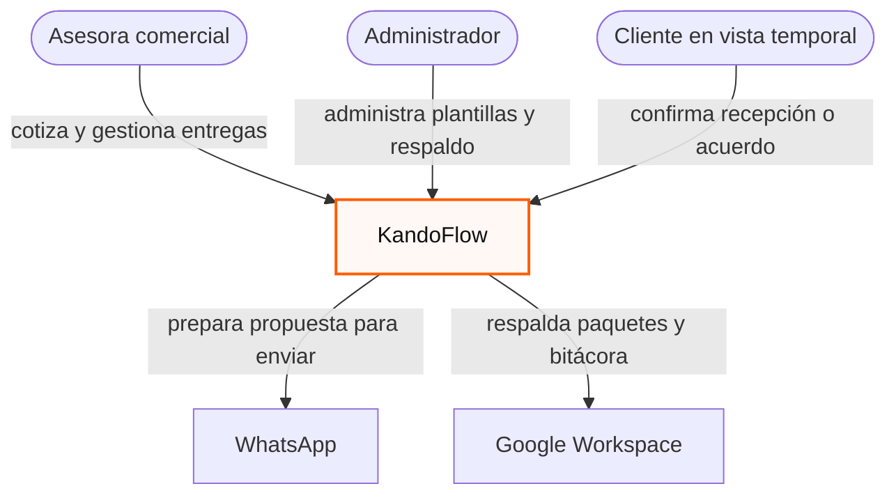
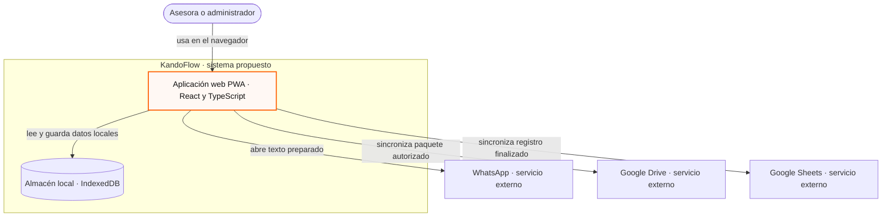
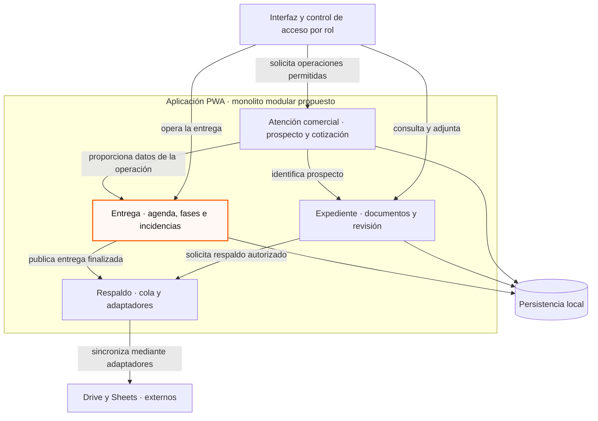
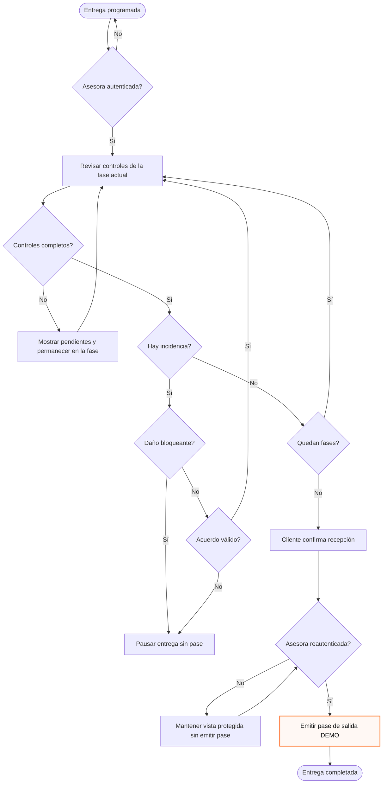
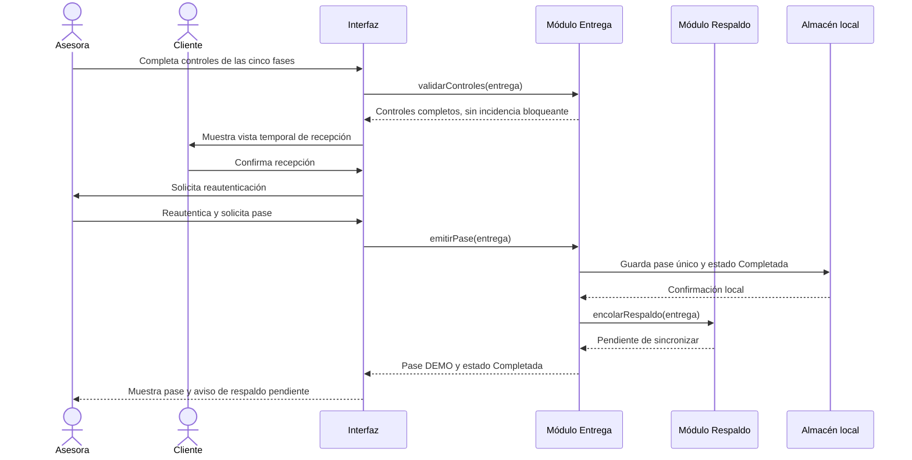
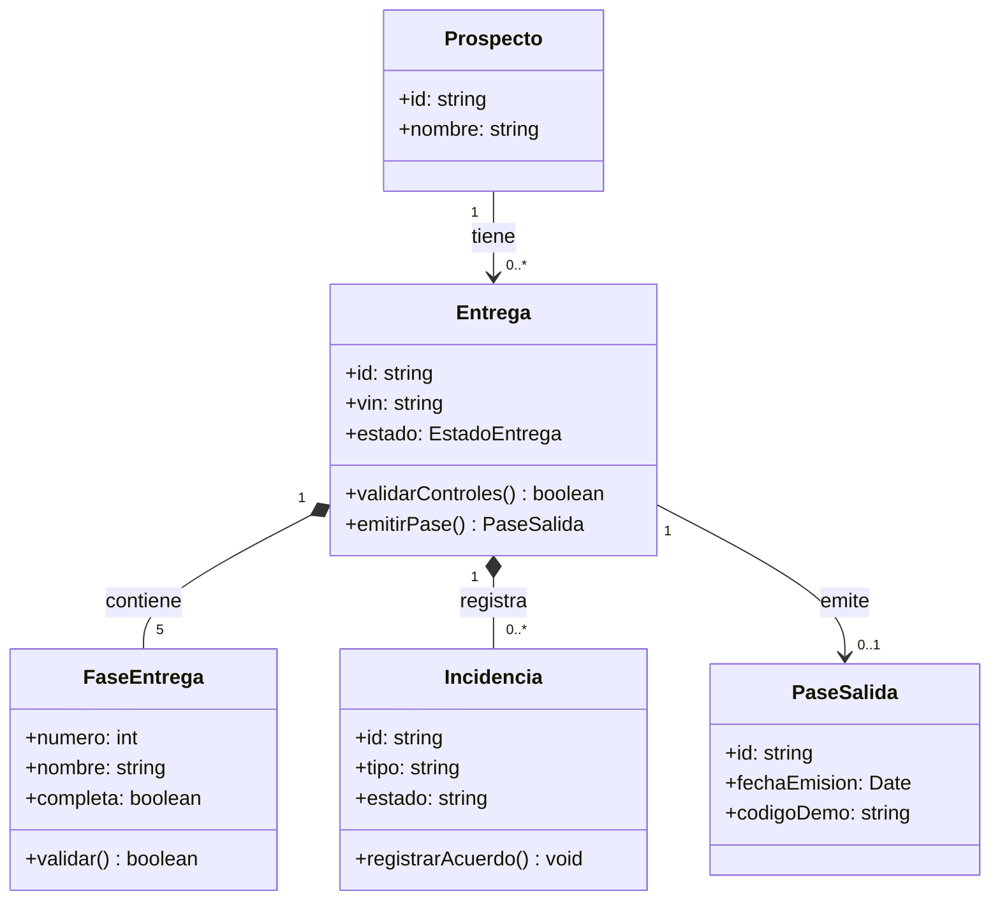
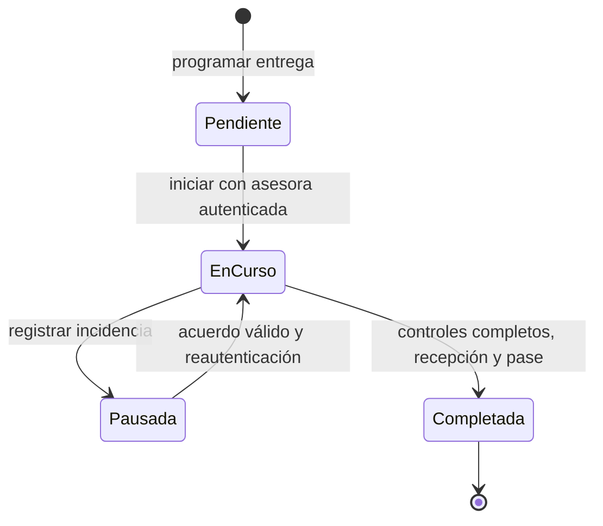
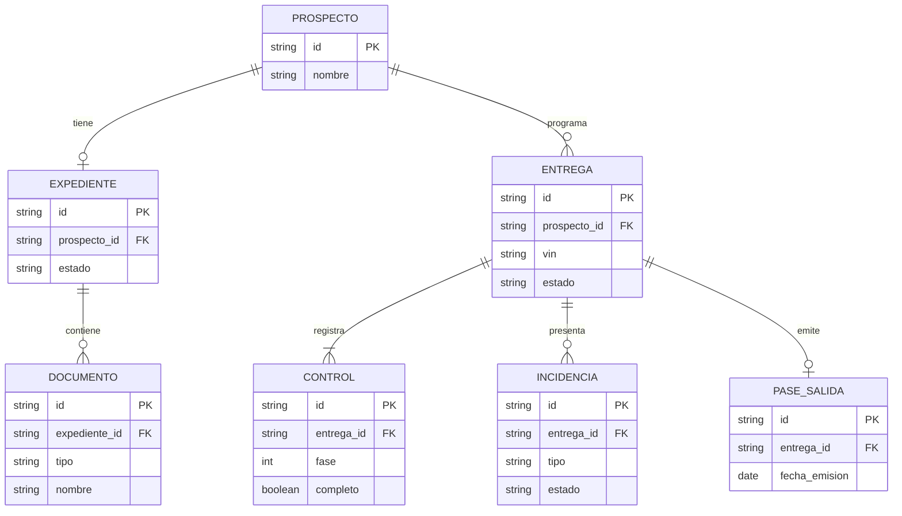

# Diagramas Mermaid de KandoFlow

**Ingeniería de Software I · SIS3407 · Unidad 3**  
**Alumno:** Rodrigo Valdespino Vertiz  
**Proyecto:** KandoFlow  
**Fecha:** 27 de octubre de 2026

Esta actividad adapta los tres niveles C4 y los cinco ejercicios de práctica de la guía del curso. Los bloques Mermaid son el entregable editable: GitHub los dibuja al abrir este archivo y permite comparar sus cambios como texto. KandoFlow se representa como una **arquitectura propuesta de monolito modular con operación local**. El prototipo de Figma ilustra los recorridos; estos diagramas no afirman que exista ya una aplicación operativa, una API propia o una integración real con Google.

## 1. Nivel 1 de C4 · Contexto

El contexto muestra a las personas y los servicios externos, sin tecnologías internas. La asesora prepara cotizaciones, expedientes y entregas; el administrador configura plantillas; el cliente solo confirma la recepción o un acuerdo en una vista temporal de la asesora. WhatsApp abre una propuesta preparada; Drive y Sheets reciben respaldo autorizado.

**Correspondencia:** CU-01 a CU-12; RF-02, RF-08, RF-15 y RF-17. La interacción del cliente está acotada a la vista temporal y exige reautenticación de la asesora para recuperar la operación.

## 2. Nivel 2 de C4 · Contenedores

La aplicación web progresiva propuesta se ejecutaría en el dispositivo de la asesora. IndexedDB es el almacén administrado por el navegador para el trabajo local; los servicios de Google y WhatsApp quedan fuera de la frontera de KandoFlow. No se dibuja un servidor propio: la visión actual no lo especifica como componente ya implementado. La autorización corporativa y el cifrado son requisitos para una implementación, no capacidades comprobadas por Figma.

**Correspondencia:** visión del producto; RF-02, RF-08, RF-17, RNF-03, RNF-04 y RNF-07. La sincronización debe dejar el trabajo pendiente cuando no hay conexión; no se da por realizada solo porque la interfaz muestre ese estado.

## 3. Nivel 3 de C4 · Componentes de la aplicación

Dentro de la PWA, los módulos se agrupan por reglas de negocio. Atención comercial conoce prospectos y cotizaciones; Expediente incorpora y revisa documentos; Entrega controla agenda, cinco fases, incidencias y pase; Respaldo traduce registros finalizados para los servicios externos. Las operaciones cruzan las fronteras mediante interfaces del módulo propietario, sin leer directamente las tablas internas de otro módulo.

**Correspondencia:** RF-01 a RF-17, en especial RF-06, RF-07, RF-08, RF-15 y RF-17. La flecha hacia Persistencia representa una interfaz común de almacenamiento, no permisos para consultar datos privados de otros módulos.

## 4. Flujo con decisiones · CU-05 y CU-06

El ejemplo muestra el punto de decisión del pase. Un control obligatorio incompleto detiene el avance; una incidencia no crítica con acuerdo válido permite retomar la fase de origen; un daño bloqueante mantiene la entrega pausada. La confirmación del cliente se hace en una vista temporal y luego la asesora se reautentica.

**Correspondencia:** CU-05, CU-06, RF-06, RF-07, RF-12 y RF-15. El pase es ficticio y no autoriza una salida real de agencia.

## 5. Secuencia · cierre de una entrega

Los mensajes muestran el orden del recorrido exitoso de la fase final. Entrega consulta sus reglas, conserva el resultado local y solicita a Respaldo encolar la sincronización. La confirmación de recepción del cliente no equivale a iniciar una sesión permanente para él.

**Correspondencia:** CU-05, RF-06, RF-08, RF-12 y RF-15. El respaldo externo puede completarse después; la falta de conexión no invalida un pase ya guardado localmente según el flujo propuesto.

## 6. Clases · datos de la entrega

El modelo conceptual separa el prospecto, su entrega y los hechos que pueden ocurrir durante ella. Una incidencia puede no existir; un pase solo puede existir cuando la entrega cumple sus reglas. Las multiplicidades reflejan el alcance del ejemplo, no una base de datos ya implementada.

**Correspondencia:** RF-06, RF-07, RF-11 y RF-12. La restricción de emitir un único pase para una entrega completa pertenece a las reglas de Entrega; la multiplicidad por sí sola no ejecuta esa validación.

## 7. Estados · ciclo de vida de la entrega

Una entrega programada pasa a En curso cuando la asesora inicia el recorrido. Si se reporta una incidencia, queda Pausada; un acuerdo permitido y la reautenticación dejan retomar la misma fase. Una entrega con controles completos y sin bloqueo llega a Completada al emitir el pase. El diagrama no introduce una cancelación que el alcance no describe.

**Correspondencia:** CU-05 y CU-06; RF-06, RF-07, RF-11 y RF-12. Pausada no habilita el pase y un daño bloqueante no satisface la transición de retorno.

## 8. Entidad-relación · persistencia conceptual

El esquema ejemplifica cómo podrían persistirse los datos del prospecto, expediente y entrega. Las entidades del expediente y de la entrega se enlazan por el prospecto; no se introduce una tabla para cada pantalla. Los servicios Drive y Sheets quedan fuera de este modelo local.

**Correspondencia:** RF-03, RF-04, RF-06, RF-07, RF-10, RF-11 y RF-12. `ENTREGA` tiene muchos controles porque el checklist se compone de las cinco fases; la regla de completitud se valida en el módulo, no por el diagrama entidad-relación.

## Relación entre las vistas

Los tres primeros diagramas acercan la vista desde el entorno de KandoFlow hasta los módulos de la PWA. El flujo y la secuencia describen CU-05 con sus decisiones y mensajes. Clases, estados y entidad-relación muestran respectivamente estructura del dominio, ciclo de vida y persistencia conceptual de la misma entrega. Todos son **ejemplos de diseño** coherentes con la especificación y el prototipo; sus tecnologías y contratos deben validarse al implementar el sistema.
