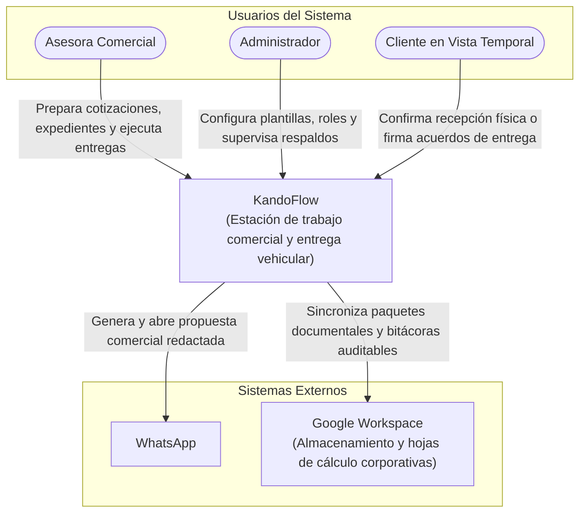

# Diagramas de Arquitectura y Decisión Técnica · KandoFlow

**Sistema:** KandoFlow (Estación de trabajo comercial y entrega vehicular)  
**Autor:** Rodrigo Valdespino Vértiz  
**Materia:** Ingeniería de Software I · SIS3407 · Unidad 3  

---

## 1. Diagrama de Contexto (Nivel 1 C4)

El sistema KandoFlow representado como una sola caja, junto a las personas que lo operan y los sistemas externos con los que se comunica, sin mención de tecnologías.



---

## 2. Diagrama de Contenedores (Nivel 2 C4)

Desglose de las piezas que se despliegan por separado, indicando las tecnologías asignadas a cada una y el protocolo o mecanismo de comunicación entre ellas.

```mermaid
flowchart TD
    U([Asesora / Administrador])

    subgraph Dispositivo_Movil["Dispositivo Local (PWA en Navegador)"]
        SPA["Aplicación Web Progresiva (PWA)\n[React + TypeScript + Vite]\nInterfaz de usuario y reglas de negocio"]
        LOCAL_DB[("Almacén de Datos Local\n[IndexedDB]\nPersistencia offline, estados de entrega y caché")]
    end

    subgraph Servicios_Externos["Servicios Externos Corporativos"]
        EXT_WA["WhatsApp Web / App Externa\n[Deep Link / URI Protocol]"]
        EXT_DRIVE["Google Drive\n[HTTPS / REST API v3]"]
        EXT_SHEETS["Google Sheets\n[HTTPS / REST API v4]"]
    end

    U -->|Operación directa en pantalla táctil / navegador| SPA
    SPA -->|Lectura y escritura transaccional asíncrona (IndexedDB API)| LOCAL_DB
    SPA -->|Apertura de URI scheme con mensaje precargado (https://api.whatsapp.com)| EXT_WA
    SPA -->|Sincronización de expedientes y pases PDF (OAuth 2.0 + JSON/HTTPS)| EXT_DRIVE
    SPA -->|Actualización de bitácora comercial y estados (OAuth 2.0 + JSON/HTTPS)| EXT_SHEETS
```

---

## 3. Diagrama de Componentes (Nivel 3 C4)

Estructura interna del contenedor donde residen las reglas de negocio (`PWA React/TypeScript`), desglosando los módulos de dominio definidos para la operación automotriz.

```mermaid
flowchart TB
    UI["Interfaz de Usuario & Control de Acceso por Rol (React Views)"]

    subgraph PWA_Container["Contenedor PWA (Monolito Modular en Cliente)"]
        subgraph Modulos_Dominio["Módulos de Reglas de Negocio"]
            MOD_COM["Módulo Atención Comercial\n- Catálogo y cálculo de cotizaciones\n- Registro y seguimiento de prospectos"]
            MOD_EXP["Módulo Expediente\n- Recepción y control de documentos\n- Validación de checklist de crédito"]
            MOD_ENT["Módulo Entrega Vehicular\n- Protocolo de 5 fases de entrega\n- Gestión de incidencias y acuerdos\n- Validación y emisión de pase de salida"]
            MOD_RESP["Módulo Respaldo & Sincronización\n- Gestor de cola offline (Queue Manager)\n- Adaptadores de conexión externa"]
        end

        STORAGE_ADAPTER["Adaptador de Persistencia Local (IndexedDB Wrapper)"]
    end

    LOCAL_STORE[("IndexedDB Local")]
    CLOUD["Servicios Cloud (Google Drive / Sheets)"]

    UI -->|Invoca acciones comerciales| MOD_COM
    UI -->|Carga y consulta documentos| MOD_EXP
    UI -->|Ejecuta fases y bloqueos| MOD_ENT

    MOD_COM -->|Provee prospecto y datos de venta| MOD_EXP
    MOD_COM -->|Transfiere datos de la unidad vendida (VIN)| MOD_ENT

    MOD_EXP -->|Solicita encolar respaldo documental| MOD_RESP
    MOD_ENT -->|Notifica pase emitido o cierre de entrega| MOD_RESP

    MOD_COM -->|Lectura / Escritura| STORAGE_ADAPTER
    MOD_EXP -->|Lectura / Escritura| STORAGE_ADAPTER
    MOD_ENT -->|Lectura / Escritura| STORAGE_ADAPTER

    STORAGE_ADAPTER -->|Consultas locales directas| LOCAL_STORE
    MOD_RESP -->|Peticiones HTTPS autenticadas| CLOUD
```

---

## 4. Architecture Decision Record (ADR)

### ADR-001: Selección del Patrón Arquitectónico para KandoFlow (Monolito Modular PWA con Operación Local)

#### 1. Título
Adopción de un Monolito Modular PWA con soporte Offline-First para la Estación de Trabajo Comercial KandoFlow.

#### 2. Estado
Aprobado.

#### 3. Contexto
La operación comercial automotriz en agencia (piso de venta, patio de maniobras y bahías de entrega) presenta condiciones frecuentes de conectividad de red inestables o nulas. Las asesoras comerciales necesitan cotizar, revisar expedientes y, de forma crítica, ejecutar la inspección física de entrega vehicular de cinco fases sin depender de conexión continua a un servidor central. Si la red se interrumpe durante la inspección o entrega, la emisión del pase de salida y el registro de incidencias no pueden detenerse.

Por otro lado, adoptar una arquitectura distribuida de microservicios o depender de un servidor de backend dedicado introduce costos operativos innecesarios, sobrecarga de infraestructura, latencia de red y riesgo de bloqueo operativo ante caídas de enlace. Se requiere mantener una separación limpia y robusta de dominios (`Comercial`, `Expediente`, `Entrega`, `Respaldo`) sin incurrir en la complejidad de múltiples servicios remotos.

#### 4. Decisión
Se decide implementar KandoFlow bajo el patrón de **Monolito Modular dentro de una Progressive Web Application (PWA)**:
1. **Artefacto único en cliente:** La aplicación se despliega como un ejecutable web unificado (React + TypeScript + Vite) en el navegador del dispositivo móvil/tablet de la asesora.
2. **Modularidad estricta:** La lógica de negocio se divide en módulos desacoplados con límites de dominio claros: *Atención Comercial*, *Expediente*, *Entrega Vehicular* y *Respaldo*. Cada módulo expone interfaces públicas de interacción; ningún módulo accede directamente a las estructuras de datos privadas de otro.
3. **Persistencia local primaria (Offline-First):** Se utiliza `IndexedDB` en el dispositivo como almacén transaccional principal. El checklist de las cinco fases, la gestión de incidencias y la emisión del pase DEMO se ejecutan y validan de forma local e inmediata.
4. **Respaldo eventual asíncrono:** La integración corporativa se delega al módulo de Respaldo, el cual gestiona una cola de sincronización hacia Google Workspace (Drive y Sheets) cuando se detecte conexión disponible.

#### 5. Consecuencias
- **Positivas:**
  - **Autonomía operativa total:** La asesora puede operar en patio y emitir pases de entrega sin interrupciones ni latencias por fallas de red.
  - **Sin costo de infraestructura de backend dedicado:** No requiere aprovisionamiento, mantenimiento ni monitoreo continuo de servidores o clústeres en la nube.
  - **Alta cohesión y mantenibilidad:** Los límites de dominio definidos permiten que, si en el futuro se requiere conectar un módulo a un ERP/DMS centralizado, la migración se realice por módulo sin reescribir la interfaz ni el resto del sistema.
- **Negativas:**
  - **Dependencia de la seguridad en el cliente:** La persistencia local en navegador exige controles estrictos de reautenticación por rol (especialmente tras la confirmación del cliente en vista temporal) y cifrado de datos sensibles en el dispositivo.
  - **Manejo de sincronización y concurrencia:** El modelo offline-first requiere resolver posibles colisiones o estados desactualizados al sincronizar registros hacia Google Sheets mediante marcas de tiempo (timestamps).